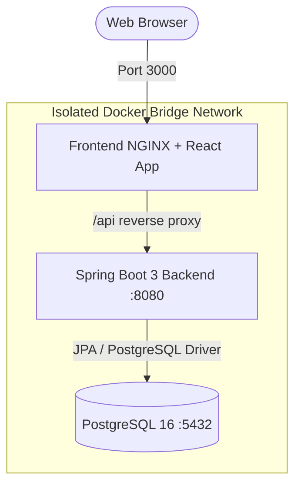

# BookHaven - Cloud FullStack E-Commerce Bookstore Platform

> **Capstone Project**: React + Java Spring Boot + PostgreSQL full-stack application containerized with Docker Compose.

---

## 🌟 Key Features & Requirements

- **Landing & Catalogue**:
  - Filter books by Category, Brand/Publisher, and real-time Search.
  - Sorting by Price, Rating, and Title.
  - Tentative delivery dates calculated and tagged on every book card and detail view.
  - Related books dynamically displayed based on active category and author.
- **Smart Shopping Basket**:
  - Real-time quantity adjustments, subtotal, and tax/shipping calculations.
  - Recommendation engine suggesting titles based on user purchase history.
- **Checkout & Payment**:
  - Select existing delivery address or create a new delivery address on the fly.
  - Redeem **Gift Points** (10 points = $1.00 instant discount).
  - Multiple payment options (Credit Card, Debit Card).
  - Purchase completion confirmation screen with estimated delivery timeline.
- **Order History & Management**:
  - Itemized order history with live status tracking (`PROCESSING`, `SHIPPED`, `DELIVERED`, `CANCELLED`).
  - **48-Hour Free Order Cancellation**: Active cancellation button and countdown window.
  - **Buy It Again**: One-click re-ordering of previously purchased items.
- **OpenAPI / Swagger 3.0 Documentation**: Fully documented REST API endpoints.

---

## 🏗️ Architecture & Zero-Prerequisite Setup



### **Run on Any Machine with Docker**
You **do not need** to install Node.js, Java, Maven, or PostgreSQL locally. Everything runs inside lightweight, multi-stage Docker containers.

```bash
# Clone the repository and navigate into the folder:
cd capstoneproject

# Build and start all 3 services:
docker compose up --build
```

---

## 🌐 Application URLs

| Service | URL | Description |
| :--- | :--- | :--- |
| **Frontend Application** | [http://localhost:3000](http://localhost:3000) | Full responsive React storefront |
| **Backend REST API** | [http://localhost:8080/api](http://localhost:8080/api) | Spring Boot REST endpoints |
| **Swagger UI Documentation** | [http://localhost:8080/swagger-ui.html](http://localhost:8080/swagger-ui.html) | Interactive OpenAPI 3.0 explorer |
| **PostgreSQL Database** | `localhost:5432` (`bookstoredb`) | Pre-seeded relational database |

---

## 👤 Pre-Seeded Test Accounts

| Full Name | Username / Email | Password | Gift Points Balance |
| :--- | :--- | :--- | :--- |
| **John Doe** | `john.doe@example.com` | `password123` | **250 Points** (Has active 48h orders) |
| **Sarah Smith** | `sarah.smith@example.com` | `password123` | **180 Points** |
| **Store Admin** | `admin@bookstore.com` | `admin123` | **500 Points** |

---

## 📁 Repository Structure

```text
├── database/
│   └── init.sql                  # PostgreSQL relational schema and realistic seed data
├── backend/
│   ├── Dockerfile                # Multi-stage Maven 3.9 + Temurin 17 JRE Dockerfile
│   ├── pom.xml                   # Spring Boot 3.2.4 dependencies
│   └── src/main/java/com/bookstore/
│       ├── BookstoreApplication.java
│       ├── config/               # CORS and OpenAPI Swagger configurations
│       ├── controller/           # Auth, Books, Categories, Brands, Addresses, Orders
│       ├── dto/                  # Request & Response DTOs with validation
│       ├── entity/               # JPA Entities (Book, Order, Category, Brand, User, Address)
│       ├── exception/            # Global Exception Handler
│       ├── repository/           # Spring Data JPA Repositories
│       └── service/              # Business logic (Order cancellation, Points, Recommendations)
├── frontend/
│   ├── Dockerfile                # Multi-stage Node 20 + NGINX Alpine Dockerfile
│   ├── nginx.conf                # NGINX reverse-proxy configuration
│   ├── package.json              # React 18, React Router, Tailwind, Lucide Icons
│   ├── tailwind.config.js
│   ├── vite.config.js
│   └── src/
│       ├── api/                  # Axios API clients
│       ├── components/           # Navbar, Footer, BookCard, CategoryCard, LoginModal
│       ├── context/              # AuthContext (Points & User) & CartContext
│       └── pages/                # Home, Catalogue, BookDetail, Cart, Checkout, Confirmation, OrderHistory
└── docker-compose.yml            # Orchestration file for Postgres, Backend, and Frontend
```

---

## 🧪 Testing the Capstone Workflows

1. **Browse Catalogue by Category & Publisher**:
   - Go to [http://localhost:3000/catalogue](http://localhost:3000/catalogue).
   - Filter by *Technology & Programming* or *O'Reilly Media*.
2. **Product Details & Tentative Delivery**:
   - Click any book to view estimated arrival dates, ISBN, and related book suggestions.
3. **Cart & Order History Recommendations**:
   - Add items to the basket and visit [http://localhost:3000/cart](http://localhost:3000/cart) to see recommendations generated from past purchases.
4. **Checkout with Gift Points**:
   - Proceed to [http://localhost:3000/checkout](http://localhost:3000/checkout), select a delivery address, toggle **Apply Gift Points** to receive an instant discount, and select Credit/Debit Card.
5. **Purchase Confirmation**:
   - Submit the order to view the confirmation summary with Order ID and estimated delivery date.
6. **Order History, "Buy It Again" & 48-Hour Cancellation**:
   - Go to [http://localhost:3000/orders](http://localhost:3000/orders).
   - Find recent orders (< 48 hrs) and click **Cancel Order** to verify the cancellation window and point refund.
   - Click **Buy It Again** on any past item to instantly replenish your basket.
